# Running DOOM on Sonoff Basic R2 (ITEAD)

### *The few-euro Wi-Fi relay that switches your lamp on… while you slaughter imps.*

> **If until yesterday you felt no need to buy a Sonoff device, the time has come.**
> It costs less than a pizza and a beer, it switches any mains load on and off, and now it also runs **Doom**.
> Yes, *that* Doom. On the chip that normally takes care of your bathroom light.

<table border="0">
  <tr align="center">
    <td>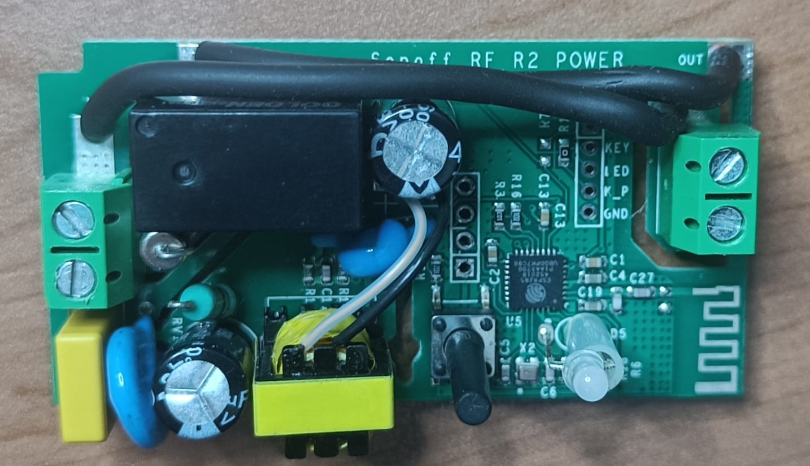</td>
    <td>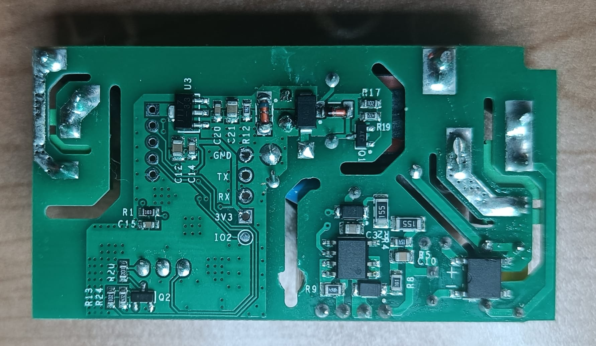</td>
  </tr>
  <tr align="center">
    <td><em>Sonoff RF R2 POWER V1.0 front side</em></td>
    <td><em>Sonoff RF R2 POWER V1.0 back side</em></td>
  </tr>
</table>


---

This repository turns a **Sonoff Basic** whose PCB is silk-screened **`Sonoff RF R2 POWER V1.0`** into two things at the same time:

1. **A proper smart switch**: setup portal on first boot, admin login, physical button, HTTP API, load state restored after a power cut.
2. **A game console**: a Doom-style FPS that **runs on the Sonoff itself** (engine, map, imps, doors, weapons) and is played from the browser, with the original menu, the marine's face, music and sound effects taken from your own `doom1.wad`.

And no, it is not a video stream from a PC hidden somewhere: the rendering is really done by the ESP8285 inside the relay.

## Screenshots

> Screenshots and clips show the shareware version of Doom &copy; id Software, running on a Sonoff. This project is not affiliated with or endorsed by id Software.

<table border="0">
  <tr>
    <td>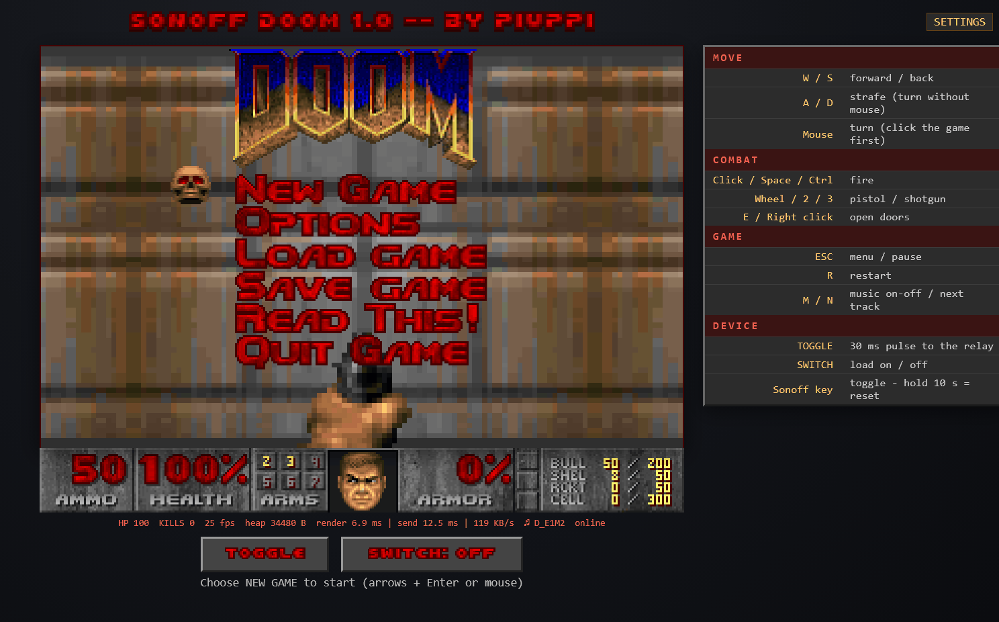</td>
    <td>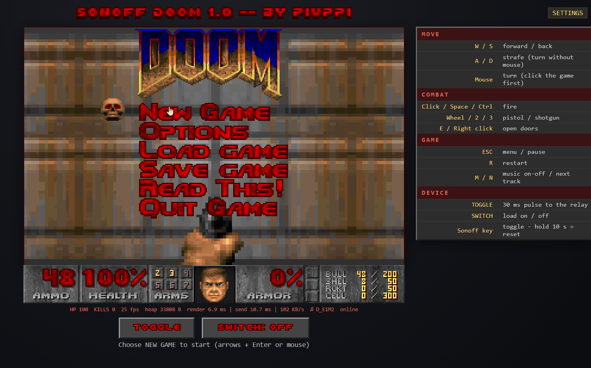</td>
  </tr>
  <tr>
    <td><em>The classic Doom menu, drawn by the browser over a wall rendered by the Sonoff.</em></td>
    <td><em>Pick a difficulty: it really changes damage, imp speed and respawn time.</em></td>
  </tr>
  <tr>
    <td>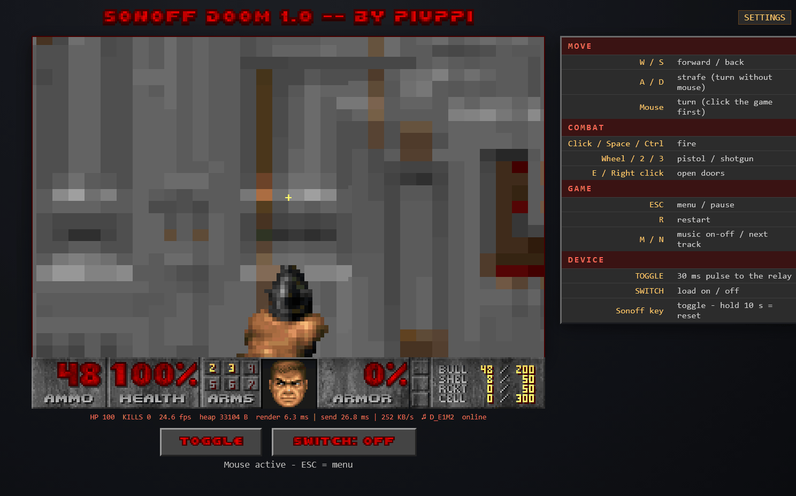</td>
    <td>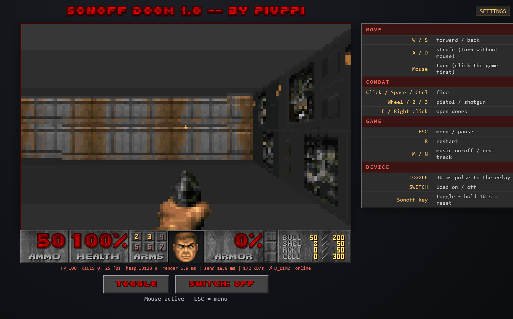</td>
  </tr>
  <tr>
    <td><em>Rising doors; imps sleep until they see or hear you, then open doors themselves.</em></td>
    <td><em>Pistol and shotgun (7 pellets with spread), switched with the mouse wheel.</em></td>
  </tr>
  <tr>
    <td>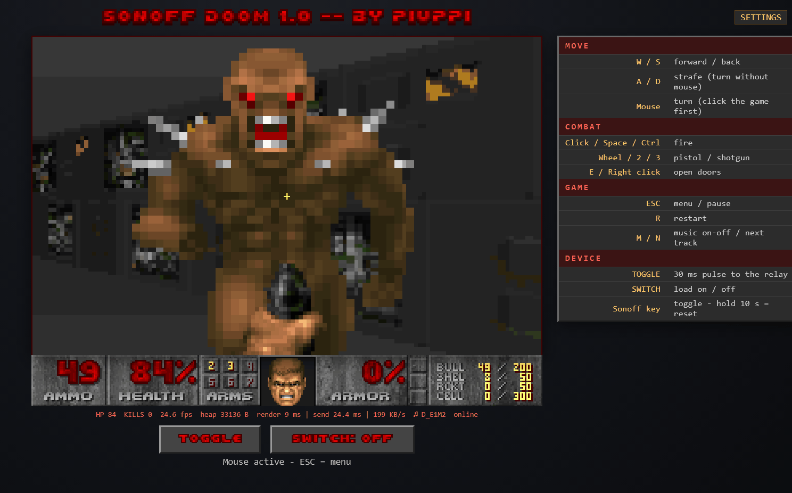</td>
    <td>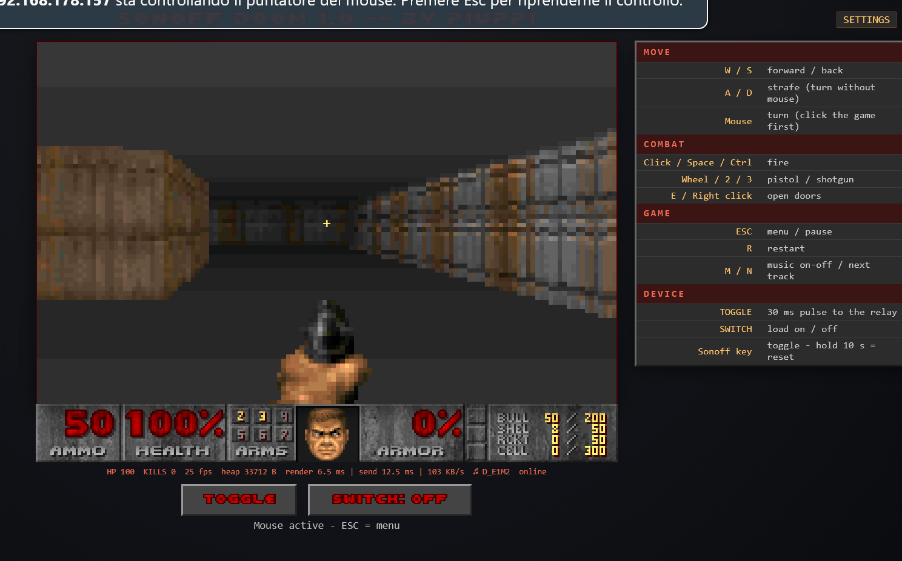</td>
  </tr>
  <tr>
    <td><em>The marine's face reacts to every hit. Red palettes are the original ones.</em></td>
    <td><em>Cheats are... politely declined.</em></td>
  </tr>
  <tr>
    <td>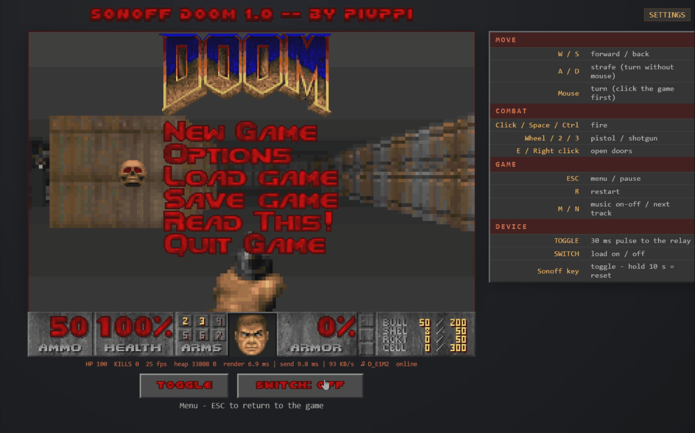</td>
    <td>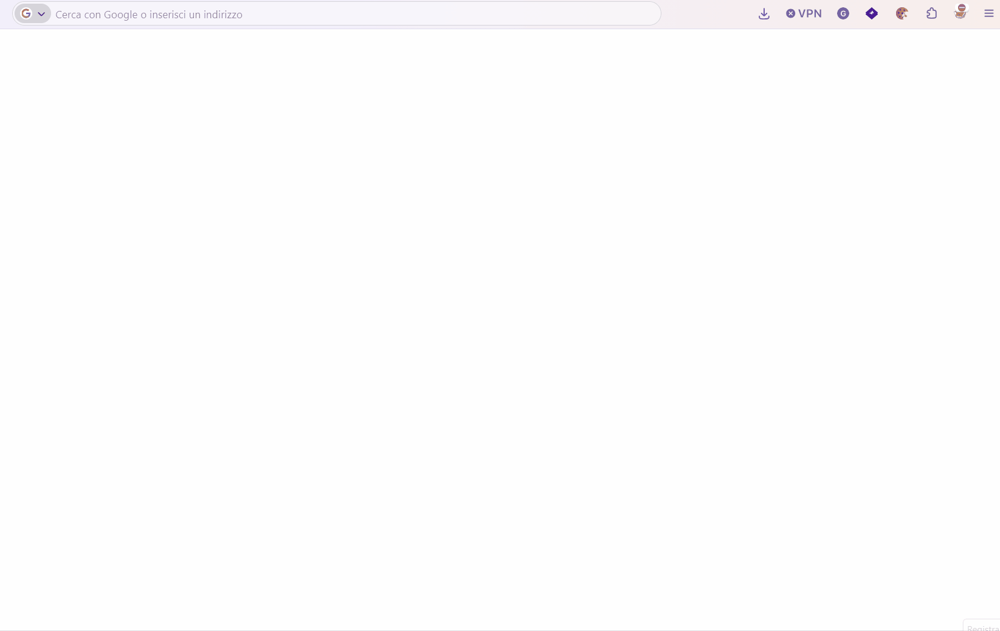</td>
  </tr>
  <tr>
    <td><em>It is still a smart switch: SWITCH toggles the load, BUTTON gives a 30 ms pulse.</em></td>
    <td><em>First boot: hotspot, setup page, then admin login.</em></td>
  </tr>
</table>


---

## Table of contents

- [What is a Sonoff (and why you should want one)](#what-is-a-sonoff-and-why-you-should-want-one)
- [What this project does](#what-this-project-does)
- [Technical specifications](#technical-specifications)
- [How it works (and how it was made)](#how-it-works-and-how-it-was-made)
- [What you need](#what-you-need)
- [Getting the game data (bring your own WAD)](#getting-the-game-data-bring-your-own-wad)
- [Step-by-step installation](#step-by-step-installation)
- [First boot](#first-boot)
- [How to use it](#how-to-use-it)
- [Still a switch: API and home automation](#still-a-switch-api-and-home-automation)
- [Security](#security)
- [Repository layout](#repository-layout)
- [`wad2sonoff.py` options](#wad2sonoffpy-options)
- [Troubleshooting](#troubleshooting)
- [Known limitations](#known-limitations)
- [Version history](#version-history)
- [Credits and legal notes](#credits-and-legal-notes)

---

## What is a Sonoff (and why you should want one)

**Sonoff** is the smart-home brand of **ITEAD**. The family is huge, but the piece we care about is the humblest one: the **Sonoff Basic** (shops also sell it as **Basic R2**), a small box with a relay inside, 2.4 GHz Wi-Fi, two input terminals and two output terminals. You put it **in series with a load** (a lamp, a fan, a pump, the coffee machine) and that load becomes remotely controllable.

According to the manufacturer's manual, the Basic R2 handles **up to 10 A / 2200 W**, accepts **100–240 V AC** and supports **2.4 GHz Wi-Fi only** (IEEE 802.11 b/g/n, no 5 GHz).

Out of the box you control it with the **eWeLink** app, and according to the Amazon and shop listings it also works with **Alexa**, **Google Home** and **IFTTT**, with timers, schedules and scenes.

**Why it is a great thing to hack on:**

| | |
|---|---|
| 💶 **Price** | About **€7–9** at the Italian shops I checked in October 2026 (prices change all the time and depend on shipping) |
| 🧠 **Brain** | An **ESP8285**: an ESP8266 with 1 MB of flash already inside the chip. Built-in Wi-Fi, programmable from the Arduino IDE |
| 🔌 **Programming pads** | 3V3, RX, TX, GND are exposed on the board: a few-euro USB-serial adapter is all you need |
| 🔘 **Button and LED** | The on-board button and LED are already wired to chip pins |
| 🏠 **Real usefulness** | Even if you never play, it is still an excellent home switch |

**Where to buy:** the official Sonoff/ITEAD store, specialised home-automation retailers, Amazon and online marketplaces. Make sure the box really contains the model you need: shops also sell newer generations (R3, R4, Basic with Matter…) with different boards.

> ⚠️ **This project is written and tested for the PCB marked `Sonoff RF R2 POWER V1.0` (Sonoff Basic).** Check the silk-screen on your board *before* doing anything.
>
> 📡 **About the name:** the "RF" in that silk-screen does **not** mean the 433 MHz radio. This is the **Wi-Fi-only** revision of the Basic, built around the **ESP8285** and on the market since around November 2018. A separate Sonoff model with a 433 MHz receiver (the Sonoff RF) also exists: **it is not the one this project targets**, and I cannot promise its pins are the same. The same goes for other revisions and generations of the Basic.

**Home-automation integrations with the original firmware** (the one in the box):

- **eWeLink** app: remote control, timers, scenes.
- **Alexa**, **Google Home**, **IFTTT**.
- **Home Assistant**, through the [official eWeLink add-on](https://sonoff.tech/blogs/news/how-sonoff-works-with-home-assistant) (it requires a Home Assistant OS / Supervisor installation) or the community component [SonoffLAN](https://github.com/AlexxIT/SonoffLAN), which talks to devices running the original firmware over the local network and/or the cloud.

**With the firmware in this repository** the original firmware is replaced: eWeLink, Alexa and Google Home through the Sonoff cloud no longer work. In exchange you get a local HTTP API, with no cloud and no account, that you can use from Home Assistant, Node-RED, scripts, curl… See [Still a switch](#still-a-switch-api-and-home-automation).

---

## What this project does

### 🎮 The game

- **Raycasting engine** on the ESP8285, **128 × 80 pixels, 256 colours**, about **23–25 fps**.
- **Real Doom graphics**, extracted *on your PC* from your `doom1.wad`: wall textures, animated imp, pistol and shotgun, original palette and lighting (COLORMAP table).
- **Classic Doom menu** at start-up, with the logo, the blinking skull, the difficulty choice and the three option sliders, over a brick wall.
- **Original status bar** with ammo, health, ARMS and the **marine's face**: it looks around, gets bloodier with every hit, turns towards whoever attacks it, grimaces, and eventually dies.
- **Doom-style page title** drawn with the WAD's red pixel font.
- **Two weapons**: pistol and **shotgun** (7 pellets with spread, pump animation, about one shot per second). Switch with the **mouse wheel** or keys **2/3**.
- **Real doors** (BIGDOOR2 texture) that rise upwards, with the original sounds. Open them with **E** or **right click**; they stay open 4.3 seconds and close again, and reopen if you stand under them.
- **Imps with a bit of a brain**: they sleep until they see you or hear a gunshot, then chase you and **open doors by themselves**.
- **Original music** (E1M1, E1M2, E1M3) played by the browser with a synthesizer, plus **sound effects from the WAD**.
- **Cheats** `IDDQD` and `IDKFA`: try them and a message in the Doom font politely explains that a relay cannot do that.
- **Smooth mouse look** with adjustable sensitivity and a jitter filter.
- **Difficulty levels** that really change the game: damage, imp speed and respawn time.

### 💡 The switch

- Below the status bar, two Doom-styled buttons:
  - **TOGGLE**: a **30 ms** pulse on the relay (for door entry systems, gates, anything that wants a "tap"). It turns green while you press it, and the on-board LED lights for the length of the pulse.
  - **SWITCH: ON/OFF**: turns the load on and off (green when on).
- **Physical Sonoff button**: short press = toggle the load. Held for **10 seconds** = factory reset.
- **Saved state**: after a power cut the load goes back to how it was.
- **HTTP API** to plug it into your home automation.
- **First boot with a hotspot and a configuration page** (home Wi-Fi + admin user and password), then a login on every page.
- **Several devices at once**: every logged-in browser can use TOGGLE and SWITCH (and sees the other's actions); the game itself goes to one browser only (the last one that takes it).

### 🖥️ The page

From top to bottom: the title, the game screen with the original status bar, a small line of live stats (HP, kills, fps, free RAM, frame timings, music track, connection), then TOGGLE and SWITCH. On wide screens (about 1480 px and up) the controls legend sits on the right and the game stays centred; on narrower screens it goes below. A **SETTINGS** link in the top-right corner opens the configuration page.

---

## Technical specifications

### Hardware

| | |
|---|---|
| **Device** | Sonoff Basic (sold as *Basic R2*) |
| **PCB silk-screen** | `Sonoff RF R2 POWER V1.0` |
| **Full name used in this repository** | **Sonoff RF R2 POWER V1.0 (Sonoff Basic)** |
| **SoC** | ESP8285 (ESP8266 + 1 MB of built-in flash), 2.4 GHz Wi-Fi |
| **Data RAM** | 80,192 bytes total (about **33 KB free** while the game is running) |
| **Flash** | 1 MB |
| **Firmware size** | about 565 KB (565,392 bytes written to the chip with v6; later versions were not re-measured) |
| **Relay** | 10 A / 2200 W (manufacturer's manual) |
| **Arduino IDE board** | *Generic ESP8285 Module* |

### Pins used

| GPIO | Function |
|---|---|
| **12** | Relay (high = closed) |
| **13** | LED (on when the pin is low). It mirrors the relay: lit while the contact is closed |
| **0** | Physical button (`KEY` pad) |
| **1 / 3** | Serial TX / RX (monitor at 115200 baud) |

These are the pins of this PCB. On the `Sonoff RF R2 POWER V1.0` **GPIO14 is no longer wired to a pad**; **GPIO2** (silk-screened `IO2`) is available instead, but it has no hole for a pin and would have to be soldered directly onto the copper. **This project does not use it**, so you do not have to solder anything.

The four programming pads are **3V3, RX, TX, GND**. Holding the button while you power the board puts the chip in upload mode.

### Measured performance

Measured on a real Sonoff, with the game page open (values from the stats line under the screen):

| | |
|---|---|
| **Frames per second** | about **23.7** |
| **Computing one frame** | about **6.4 ms** |
| **Sending one frame over Wi-Fi** | about **28.8 ms** |
| **Traffic** | about **242 KB/s** |
| **Bottleneck** | the **Wi-Fi**, not the computation |
| **Free RAM** | about **33 KB** |

The amount of data per frame depends on what you are looking at: in PC simulations with the real assets it ranged from about 3 KB in open rooms up to about 10 KB when standing right in front of a wall (see [the engine](#the-engine-on-the-sonoff)).

---

## How it works (and how it was made)

### The idea

The original Doom needs at least **4 MB of RAM**, and even the most aggressive microcontroller ports use hundreds of KB. The Sonoff has **80 KB**, of which about 33 KB remain with Wi-Fi on. So **Doom's engine cannot be ported**.

The solution is a **new engine, written from scratch for this chip**, that uses **real Doom data**:

- The **geometry** is a 16 × 16 grid (the engine is a raycaster, not the original BSP renderer).
- **Textures, sprites, palette and lighting** come from the WAD, are converted on the PC and live in **flash**, read straight from there without going through RAM.
- The **browser** does everything that would cost RAM: it draws the menu, status bar and texts, and plays music and effects.

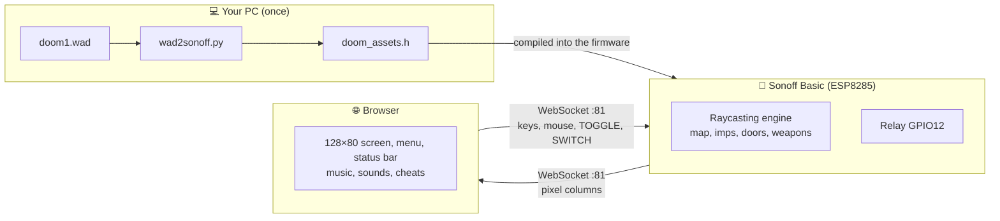

### The engine on the Sonoff

- **No framebuffer**: a 128 × 80, 256-colour screen is 10 KB, which does not fit. The Sonoff renders **16 columns at a time** into a buffer of about 1.3 KB and sends them right away.
- **Only what is needed is sent**: floor and ceiling are uniform colours per row, so the browser draws them. For every column the Sonoff only sends the part that differs: walls, imps and the weapon.
- **Textures from flash**: the 64 × 64 walls and the sprites are stored column by column and read with `pgm_read_byte`. Sprites are cropped to their bounding box to save space.
- **Doom lighting**: 16 of the 32 levels of the COLORMAP table, according to distance (and slightly darker on side walls).
- **Rising doors**: the ray passes through the free gap under the door and the engine draws the room behind it, imps included.
- **Imp AI**: dormant, woken up by sight (with a line-of-sight check through walls and doors) or by the noise of gunshots. They open closed doors they run into.
- **Smooth mouse**: the browser sends the **total rotation**, not individual movements. The Sonoff only uses the difference and turns by a limited angle per update, so queued-up messages cannot cause sudden spins.
- **Accurate 30 ms pulse**: it is ended by a hardware timer (timer1), not by the main loop, so it lasts 30 ms even while the Sonoff is drawing a frame. Relay and LED are restored together inside the timer interrupt.
- **Menu background**: the wall behind the menu is a fixed scene rendered on request for any browser that opens the page, without touching a game in progress.

### The browser

The page (about 32 KB, compressed to about 13 KB inside the firmware):

- rebuilds the image from the columns it receives and applies the **Doom palette**;
- draws the **title**, **status bar**, **face**, **menu**, messages and **cheat popups** with the WAD's **original font**;
- decodes the **sound effects** (4-bit ADPCM compressed) and plays them;
- reads the **MUS** scores and plays them with a **WebAudio synthesizer** (distorted guitar, bass, piano, strings, drums…);
- handles keyboard, mouse and wheel.

### Data conversion: `wad2sonoff.py`

A pure Python 3 script, with no external modules, that reads the WAD and generates **`doom_assets.h`**:

| What | How |
|---|---|
| Palette and lighting | PLAYPAL (all 14 palettes, including the red hit ones) and COLORMAP |
| Walls | Textures composed from the WAD patches, scaled to 64 × 64 |
| Door | BIGDOOR2 |
| Imp | 10 frames (walk, pain, death) |
| Weapons | Pistol and shotgun with muzzle flash and pump, pre-scaled to 128 × 80 |
| Menu, status bar, font | Original patches (`M_*`, `ST*`, `STCFN*`) |
| Sound effects | DMX samples resampled and compressed to 4-bit ADPCM |
| Music | MUS tracks, compressed |
| Web page | `index_html.h` compressed with gzip |

All graphic and audio material is served by the Sonoff as compressed blocks (`/stbar.bin`, `/music.bin`, `/`), read from flash.

### How it came about

The project started as an experiment ("can Doom run on a Sonoff?") with an honest answer: *the original Doom, no; a new engine, yes*. It then grew in small steps, from a raycaster with made-up graphics to the current version, with every milestone tested step by step on a real Sonoff device.. It was written in dialogue with **Claude Opus 5.5**, which produced the code while hardware tests showed what worked and what did not.

---

## What you need

| | |
|---|---|
| 🔌 **A Sonoff Basic** with a `Sonoff RF R2 POWER V1.0` PCB | Better one you do not need for switching anything important until you are sure of the result |
| 🔧 **3.3 V USB-serial adapter** | CP2102, CH340, FT232… **not 5 V** |
| 🪢 **4 Dupont wires** | Four connections: 3V3, GND, TX, RX |
| 🔥 **Soldering iron** (optional) | May help with pin headers, if you do not want to hold the wires by hand |
| 💻 **Arduino IDE** | With the **esp8266** core and the **WebSockets** library by Markus Sattler (Links2004) |
| 🐍 **Python 3** | For `wad2sonoff.py` |
| 📀 **`doom1.wad`** | The shareware version, which you download yourself (see below) |
| 🌐 **A modern browser** | Chrome, Edge, Firefox |

> ## ☠️ ELECTRICAL SAFETY
>
> The Sonoff is a **mains-powered** device. While you program it, it **must not be connected to the mains**. Power it **only from the 3.3 V of the USB-serial adapter**, and **never** from the mains and the PC at the same time.
> With the board exposed, remember that some parts are at mains voltage. If you are not sure what you are doing, **ask someone who is**.
> When flashing is done, put the Sonoff back in its **closed** case before connecting it to the mains with a load.
> The author is not responsible for damage to property or people.

---

## Getting the game data (bring your own WAD)

This repository contains **no Doom data**: no WAD, and no pre-converted assets. You need your own copy of the shareware `doom1.wad`.

1. Download the shareware `doom1.wad` (version 1.9: 4,196,020 bytes, MD5 `f0cefca49926d00903cf57551d901abe`), for example from the `Doom-Utils/shareware-collection` repository on GitHub, folder `Doom 1.9`.
2. Put it in the `sonoff_doom/` folder (next step shows the command).
3. The script writes `doom_assets.h`. It is derived from your WAD and is **for your personal use only**: please do not share it or commit it. The `.gitignore` already excludes it.

> The shareware package ships with its own license terms: read them before redistributing anything.

---

## Step-by-step installation

### 1. Get the code

Download this repository and put your **`doom1.wad`** in the `sonoff_doom/` folder.

### 2. Generate the assets

Open a terminal in the `sonoff_doom/` folder:

```bash
python wad2sonoff.py doom1.wad
```

The script creates **`doom_assets.h`** (about 650 KB of text, which becomes about 175 KB in the firmware). If you see an error, check that you have the right WAD file.

### 3. Set up the Arduino IDE

1. **File → Preferences → Additional boards manager URLs**, add:
   `https://arduino.esp8266.com/stable/package_esp8266com_index.json`
2. **Tools → Board → Boards Manager**: install **esp8266 by ESP8266 Community**.
3. **Library Manager**: install **WebSockets** by **Markus Sattler**.
4. Open `sonoff_doom/sonoff_doom.ino`. The `index_html.h` file shows up by itself as a second tab.

### 4. Select the board

Under **Tools**:

| Setting | Value |
|---|---|
| Board | **Generic ESP8285 Module** |
| CPU Frequency | **160 MHz** |
| Flash Size | **1MB (FS:none OTA:~502KB)** |
| Upload Speed | 115200 (safest) |
| Port | The COM port of your adapter |

> The board **must** be *Generic ESP8285 Module*: on the ESP8285 the flash works in DOUT mode, and a generic ESP8266 board may leave the chip unable to boot.

### 5. Connect the adapter

The Sonoff **disconnected from the mains**. Connect the wires to the four pads:

| Adapter | Sonoff |
|---|---|
| 3V3 | 3V3 |
| GND | GND |
| **TX** | **RX** |
| **RX** | **TX** |

(TX and RX are **crossed**.)

### 6. (Recommended) Back up the original firmware

Before overwriting everything, save the flash with `esptool` (for example `pip install esptool`):

```bash
python -m esptool --port COM3 read_flash 0x0 0x100000 sonoff_original_backup.bin
```

The Sonoff must be in upload mode (see below). With the backup you will be able to restore the factory firmware if you ever want to. *(Not tested in this project: check the command against the esptool version you install.)*

### 7. Upload the firmware

1. **Hold the Sonoff button** while you connect the adapter to the PC (which gives the board its 3.3 V), then release it.
2. In the Arduino IDE press **Upload** (the → arrow). It compiles and uploads in one go; it takes about a minute.
3. If it stays on "Connecting…", the Sonoff is not in upload mode: repeat step 1 and check the TX/RX crossing.
4. When it finishes, **remove the power and reconnect it without pressing the button**.

Open the **Serial Monitor at 115200**: you should see that the Sonoff is in setup mode.

> **What about Wi-Fi (OTA) updates?** The firmware is bigger than the roughly 500 KB available for an OTA partition, so it **is not possible**: every update has to be done **over serial**, with the button held.

---

## First boot

On the first boot (and after every factory reset) the Sonoff knows neither your Wi-Fi nor your credentials:

1. The **LED blinks slowly** and the **open** Wi-Fi network `SONOFF-DOOM-SETUP` appears.
2. Connect to it: **the configuration page opens by itself**. If it does not, go to `http://192.168.4.1`.
3. Fill in:
   - **HOME WI-FI**: pick your network (2.4 GHz) from the list or type it.
   - **WI-FI PASSWORD**.
   - **ADMIN USER**: pre-filled with `doom-admin`, you can change it.
   - **ADMIN PASSWORD** (at least 8 characters) and its repetition.
4. **SAVE**: the Sonoff stores everything and reboots.
5. After the reboot it joins your network. Open it at **`http://sonoff-doom.local`** or at its **IP address** (shown in the serial monitor or in your router). It asks for the user and password.

If your network does not answer for 20 seconds, the Sonoff turns the `SONOFF-DOOM-SETUP` hotspot back on, but the pages stay **protected by the admin password**. From the **SETTINGS** page you can change Wi-Fi and credentials at any time, or do a factory reset.

---

## How to use it

### Game controls

| Key | Action |
|---|---|
| **W / S** | Forward / back |
| **A / D** | Strafe (they turn you when the mouse is not active) |
| **Mouse** | Turn and aim (click the game first) |
| **Click / Space / Ctrl** | Fire |
| **Wheel / 2 / 3** | Pistol / shotgun |
| **E / Right click** | Open doors |
| **ESC** | Menu / pause |
| **R** | Restart |
| **M / N** | Music on-off / next track |

### Menu

When the page connects, the **Doom menu** appears over a brick wall.

- **New Game** → pick the episode (only the first is available) and the difficulty, from *I'm Too Young To Die* to *Nightmare*.
- **Options** → mouse sensitivity, effects volume, music volume (the three original sliders).
- **Read This!** → the list of controls.
- **Load / Save Game** → answers with irony: a relay cannot save.
- **Quit Game** → back to the menu.

Use the arrow keys (or **W/S**) and **Enter**, or the mouse.

### Device

| Control | Effect |
|---|---|
| **TOGGLE** | 30 ms pulse on the relay. Green while pressed, and the LED lights for the pulse |
| **SWITCH: ON/OFF** | Load on or off (turns green when on) |
| **Physical button, short press** | Toggles the load |
| **Physical button, 10 seconds** | Factory reset (the LED blinks fast from 3 seconds) |
| **LED** | Lit while the relay contact is closed (so it shows that the load is on, and blinks during a TOGGLE pulse); flashes at every shot fired; blinks slowly in setup mode |

> When you shoot, the **relay does not click**: only the LED flashes. Otherwise every shot would switch your lamp off.

### Cheats

Type **IDDQD** or **IDKFA** while playing. It will not do what you think. 😉

---

## Still a switch: API and home automation

Every request needs **HTTP Basic authentication** with the admin user and password.

```bash
# Turn on
curl -u doom-admin:YOUR_PASSWORD "http://sonoff-doom.local/relay?cmd=on"

# Turn off
curl -u doom-admin:YOUR_PASSWORD "http://sonoff-doom.local/relay?cmd=off"

# Invert the load (on <-> off)
curl -u doom-admin:YOUR_PASSWORD "http://sonoff-doom.local/relay?cmd=toggle"

# 30 ms pulse (what the TOGGLE button on the page does)
curl -u doom-admin:YOUR_PASSWORD "http://sonoff-doom.local/relay?cmd=pulse"

# Current state
curl -u doom-admin:YOUR_PASSWORD "http://sonoff-doom.local/relay"
```

The reply is a tiny JSON: `{"relay":"on"}` or `{"relay":"off"}`.

> Careful with the names: **`cmd=toggle` inverts the load** (like the SWITCH button), while the **TOGGLE button on the page sends a 30 ms pulse** (`cmd=pulse`).

### Home Assistant (example, untested)

With a `curl`-based switch, in `configuration.yaml`:

```yaml
command_line:
  - switch:
      name: "Sonoff Doom"
      command_on: 'curl -s -u "doom-admin:YOUR_PASSWORD" "http://sonoff-doom.local/relay?cmd=on"'
      command_off: 'curl -s -u "doom-admin:YOUR_PASSWORD" "http://sonoff-doom.local/relay?cmd=off"'
      command_state: 'curl -s -u "doom-admin:YOUR_PASSWORD" "http://sonoff-doom.local/relay"'
      value_template: "{{ value_json.relay == 'on' }}"
```

> I have **not tried** this example on Home Assistant: double-check the syntax against the version you run. It works in the same way with Node-RED, shell scripts, other controllers' scenes, or anything that can make an HTTP request.

The channel used by the game (WebSocket) is reserved for pages that have logged in and is not meant as a public API.

---

## Security

For a device that costs a few euros there is a reasonable amount of care:

- Every page, the API and the file-upload page require a **user and password**.
- The game's WebSocket channel only accepts browsers that have logged in (with a session code valid for that boot).
- The admin password also protects `/update`.
- Settings are stored in flash with an integrity check.

**But be aware:**

- Everything travels over **plain HTTP**: the ESP8285 cannot reasonably do HTTPS. **Passwords and commands are visible to anyone listening on your network.** That is fine at home; **do not expose the Sonoff to the Internet**.
- During the initial setup the `SONOFF-DOOM-SETUP` network is **open** and the passwords you type travel in clear. Do it at home, with nobody around.
- If you lose the admin password: **hold the physical button for 10 seconds** and start again from the setup.

---

## Repository layout

```
sonoff-doom/
├── README.md
├── LICENSE
├── .gitignore
├── docs/                   ← GIFs / screenshots
└── sonoff_doom/
    ├── sonoff_doom.ino     ← firmware: engine, network, relay, settings
    ├── index_html.h        ← web page (source)
    ├── wad2sonoff.py       ← converts the WAD into doom_assets.h
    ├── README.txt          ← quick reminder
    ├── doom1.wad           ← NOT included: you provide it
    └── doom_assets.h       ← NOT included: generated by the script
```

**Recommended `.gitignore`:**

```
doom1.wad
*.wad
doom_assets.h
*.bin
```

> `doom1.wad` and `doom_assets.h` **must not be published** in the repository: they contain id Software data (the second one in converted form).

### If you edit the web page

The page the Sonoff serves is **not the plain `index_html.h`** but a **compressed copy inside `doom_assets.h`**. After every change to `index_html.h`, refresh that copy (no WAD needed):

```bash
python wad2sonoff.py --html-only
```

Then recompile and upload. In the browser reload with **Ctrl+F5** so you do not see the old cached version.

---

## `wad2sonoff.py` options

| Option | What it does |
|---|---|
| `--list` | Lists the textures and music tracks available in the WAD |
| `--walls A,B,C` | Chooses the 3 map walls (default: `STARTAN3,COMPTALL,BROWN1`) |
| `--door NAME` | Door texture (default: `BIGDOOR2`) |
| `--music D_E1M1,D_E1M4` | Tracks to include (`none` for no music, `all` for every track: they take a lot of space) |
| `--sounds DS…` | Sound effects to include (`none` for none) |
| `--sfx-rate 8000` | Resamples the effects at a lower rate to save flash |
| `--html-only` | Only refreshes the embedded web page, no WAD needed |
| `--out FILE` | Changes the output file |

If the Arduino IDE says the sketch is **too big**: regenerate with `--sfx-rate 8000`, fewer sounds or a single music track, and recompile.

---

## Troubleshooting

| Symptom | What to check |
|---|---|
| Build stops with "doom_assets.h missing" | You did not run `python wad2sonoff.py doom1.wad` in the sketch folder |
| Build stops with "doom_assets.h is old" | Regenerate the file with the script: the firmware needs the current version |
| "Connecting…" during upload | Button not held at power-up, TX/RX not crossed, adapter at 5 V |
| The Sonoff does not boot after upload | Wrong board selected: it must be *Generic ESP8285 Module* |
| `SONOFF-DOOM-SETUP` does not appear | The Sonoff is already configured: hold the button for 10 seconds to go back to setup |
| The setup page does not open by itself | Go to `http://192.168.4.1` by hand |
| `sonoff-doom.local` does not resolve | Some devices (certain Android phones) do not support it: use the IP |
| The relay does not click with the adapter connected | With only 3.3 V the coil may not get enough voltage, but the LED still works |
| No music | Browsers only allow audio after a click or key press. Press something; then check the **M** key and the volume in Options |
| My change to the page does not show up | Did you run `--html-only`? And recompile and re-upload the firmware? Then Ctrl+F5 in the browser |
| Mouse "runs away" | Lower the sensitivity in Options |
| The game stops | Another browser has probably taken control: take it back with ESC or New Game |
| The menu background is empty | Reload the page (Ctrl+F5): the Sonoff sends the wall scene when the page connects |

---

## Known limitations

- **A single 16 × 16 map**, with all walls at the same height and uniform floor and ceiling: it is a Wolfenstein-style raycaster with the look of Doom, not the original Doom.
- **A single enemy type** (4 imps) that only attacks in melee.
- **Ammo**: there are no pickups; killed imps give you a few shots (a project choice, not Doom's).
- **You cannot save**. Really.
- **One player at a time**.
- **Simple music synthesizer**: the notes are right, but it does not sound like a Sound Blaster.
- **Plain HTTP** (see [Security](#security)).
- **No OTA updates**: firmware too large, serial only.
- Tested **only on the Sonoff Basic with the `Sonoff RF R2 POWER V1.0` PCB**.

---

## Version history

| Version | What's new |
|---|---|
| **v1** | Raycaster on the ESP8285 with code-generated graphics, frames sent to the browser |

---

## Ideas for the future

- 🩹 Medkits, ammo and armour to pick up on the map.
- 🗺️ A bigger map, designed in E1M1 style.
- 🔥 Imps that throw fireballs from a distance.
- 🏠 A panel to see the load state without opening the game.

Pull requests are welcome, as long as they stay within the roughly 33 KB of free RAM. 😄

---

## Credits and legal notes

- Project by **Piuppi**, written with **Claude Opus 5.5**.
- **Doom** is a trademark of **id Software**. This repository **contains no Doom code or data**: graphics and sound are extracted from **your own** `doom1.wad`, on **your own** PC, for **personal use**. Do not redistribute `doom_assets.h`.
- **Sonoff** and **eWeLink** are trademarks of **ITEAD / CoolKit**. This project is **not affiliated with or endorsed by** ITEAD, Sonoff, id Software or anyone else.
- Libraries used: the **ESP8266 Arduino** core, **WebSockets** by Markus Sattler (Links2004).
- The original code in this repository is released under the **MIT** licence (see `LICENSE`). The licence covers the code only, not Doom's data.

### Useful links

- Manufacturer's manual for the Basic R2: [manuals.plus – SONOFF Basic R2 user manual](https://manuals.plus/asin/B07KP8THFG.pdf)
- An Italian distributor's page for the Basic R2: [Sonoff Italia B2B](https://b2b.sonoffdomotica.it/smart-switch/3-sonoff-basic-r2.html)
- Official eWeLink add-on for Home Assistant: [Sonoff guide](https://sonoff.tech/blogs/news/how-sonoff-works-with-home-assistant)
- Community component for Sonoff devices with the original firmware: [SonoffLAN](https://github.com/AlexxIT/SonoffLAN)

---

<p align="center"><i>If you have read this far, you have already spent more time than it takes to switch on the lamp.<br>Now switch it off and go shoot some imps.</i></p>
